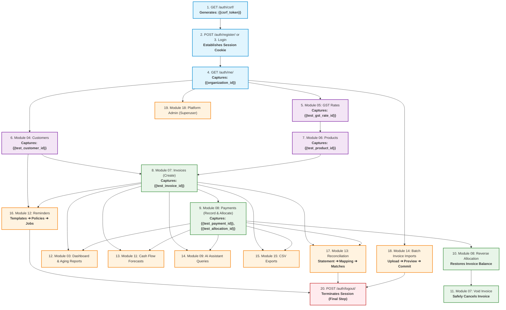
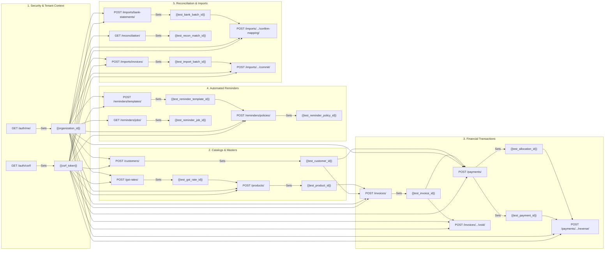

# FinPilot AI — API Dependency Map & Execution Architecture

> **Visual Architectural Dependency Reference.** Visualizes data flows, variable propagation handshakes, module hierarchies, and critical execution constraints for Postman testing.

---

## 1. High-Level System Dependency Flow

This flowchart illustrates the primary operational sequence required by the FinPilot AI backend:



---

## 2. Dynamic Variable Handshake Map

This diagram details exactly which API populates which Postman environment variable, and which downstream APIs consume that variable:



---

## 3. The Two Fatal Execution Traps

### ⚠️ Trap 1: The Early Logout Trap
```
[Unsafe Flow]
  1. CSRF ──> 2. Login ──> 3. Get Me ──> 4. Logout ❌ ──> 5. List Customers 💥 (401 Unauthorized)

[Safe Flow]
  1. CSRF ──> 2. Login ──> 3. Get Me ──> [Run APIs 5 through 86] ──> 87. Logout ✅ (Session Safely Closed)
```
* **Why it fails**: Logging out immediately removes `sessionid` from the Postman cookie jar. Since Django does not use long-lived JWT headers, every subsequent request is rejected.

---

### ⚠️ Trap 2: The Invoice Void vs Payment Allocation Trap
```
[Unsafe Flow]
  Create Invoice ──> Void Invoice ❌ ──> Record Payment with Allocation 💥 (400 Bad Request)
  *Reason: Cannot allocate funds to an invoice marked as 'void'*

[Unsafe Flow 2]
  Create Invoice ──> Record Payment ──> Void Invoice ❌ 💥 (400 Bad Request)
  *Reason: Backend raises 'Reverse existing allocations before voiding this invoice'*

[Safe Flow]
  Create Invoice ──> Record Payment (with allocation) ──> Reverse Allocation ──> Void Invoice ✅
```
* **Code Constraint (`backend/core/views.py`)**:
  ```python
  active_allocs = invoice.allocations.filter(reversed_at__isnull=True)
  if active_allocs.exists():
      return Response({"detail": "Reverse existing allocations before voiding this invoice."}, status=400)
  ```

---

## 4. Module Dependency Matrix & Prerequisites

| Module Name | Folder # | Requires Session? | Requires CSRF? | Requires `X-Organization-ID`? | Internal Pre-Requisite Data |
|---|---|---|---|---|---|
| **01 - Authentication** | 01 | No (except Me/Logout) | Yes (for Register/Login/Logout) | Only for Logout | Backend reachable |
| **02 - Organizations** | 02 | Yes | Yes (for Create/Update) | Yes (except Create Org) | Active User Account |
| **03 - Dashboard & Reports** | 03 | Yes | No (`GET`) | Yes | Organization ID |
| **04 - Customers** | 04 | Yes | Yes (for Create/Update/Opt) | Yes | Organization ID |
| **05 - GST Rates** | 05 | Yes | Yes (for Create/Update/Act) | Yes | Organization ID |
| **06 - Products** | 06 | Yes | Yes (for Create/Update/Act) | Yes | Active GST Rate ID (`test_gst_rate_id`) |
| **07 - Invoices** | 07 | Yes | Yes (for Create/Update/Void) | Yes | Customer ID (`test_customer_id`), Product ID (`test_product_id`) |
| **08 - Payments** | 08 | Yes | Yes (for Record/Reverse) | Yes | Customer ID (`test_customer_id`), Invoice ID (`test_invoice_id`) |
| **09 - AI Assistant** | 09 | Yes | Yes (`POST`) | Yes | Organization ID, Active AI Provider Key (`OPENAI_API_KEY`) |
| **10 - Notifications** | 10 | Yes | Yes (for Mark Read) | Yes | Organization ID, Existing Notification ID |
| **11 - Forecast** | 11 | Yes | No (`GET`) | Yes | Organization ID, Invoices in Database |
| **12 - Reminders / Templates** | 12 | Yes | Yes (for Create/Update/Approve) | Yes | Organization ID |
| **12 - Reminders / Policies** | 12 | Yes | Yes (for Create/Update/Auto) | Yes | Reminder Template ID (`test_reminder_template_id`) |
| **12 - Reminders / Jobs** | 12 | Yes | Yes (for Approve/Reject) | Yes | Reminder Policy evaluated, Open Invoice |
| **13 - Reconciliation** | 13 | Yes | Yes (for Upload/Mapping/Match) | Yes | Bank Statement File (`.csv`/`.xlsx`), Invoice |
| **14 - Invoice Imports** | 14 | Yes | Yes (for Upload/Commit) | Yes | Invoice CSV/XLSX File, Organization ID |
| **15 - Exports** | 15 | Yes | No (`GET`) | Yes | Organization ID |
| **16 - Audit Log** | 16 | Yes | No (`GET`) | Yes | Organization ID |
| **17 - Subscriptions** | 17 | Yes | No (`GET`) | Yes | Organization ID |
| **18 - Platform Admin** | 18 | Yes (Superuser) | No (`GET`) | No | Django Staff/Superuser Account |
| **19 - OpenAPI Schema** | 19 | No | No (`GET`) | No | None |

---

## 5. How to Obtain and Reuse IDs Manually

If you need to manually inspect or override any variable in Postman:

1. **Accessing the Postman Environment**:
   * Click the eye icon (`Quick Look`) or click **Environments** in the left sidebar -> Select `FinPilot AI - Local Dev`.
2. **Finding IDs in Responses**:
   * **Organization ID**: Found in `GET /api/v1/auth/me/` under `organizations[0].id`.
   * **Customer ID**: Found in `POST /api/v1/customers/` response under `id`.
   * **Product ID**: Found in `POST /api/v1/products/` response under `id`.
   * **Invoice ID**: Found in `POST /api/v1/invoices/` response under `id`.
   * **Payment ID**: Found in `POST /api/v1/payments/` response under `id`.
   * **Allocation ID**: Found in `POST /api/v1/payments/` response under `allocations[0].id`.
   * **Template ID**: Found in `POST /api/v1/reminders/templates/` response under `id`.
   * **Policy ID**: Found in `POST /api/v1/reminders/policies/` response under `id`.
   * **Bank Statement Batch ID**: Found in `POST /api/v1/imports/bank-statements/` response under `batch_id`.
   * **Reconciliation Match ID**: Found in `GET /api/v1/reconciliation/` response as first item's `id`.
   * **Import Batch ID**: Found in `POST /api/v1/imports/invoices/` response under `batch_id`.

